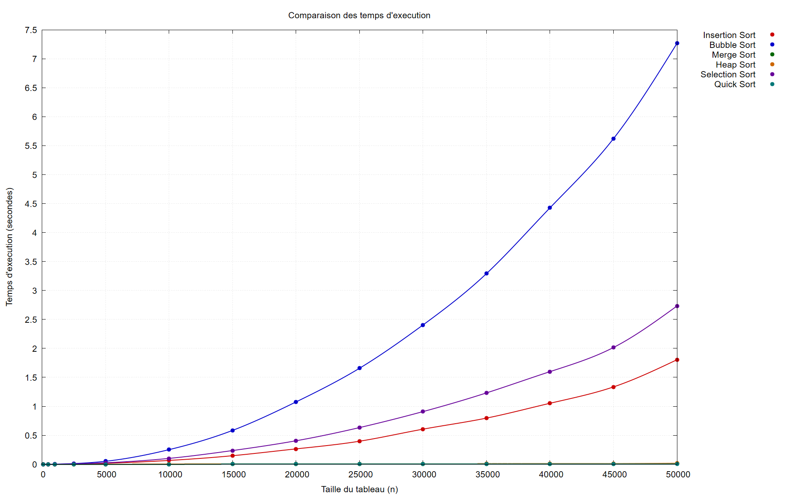
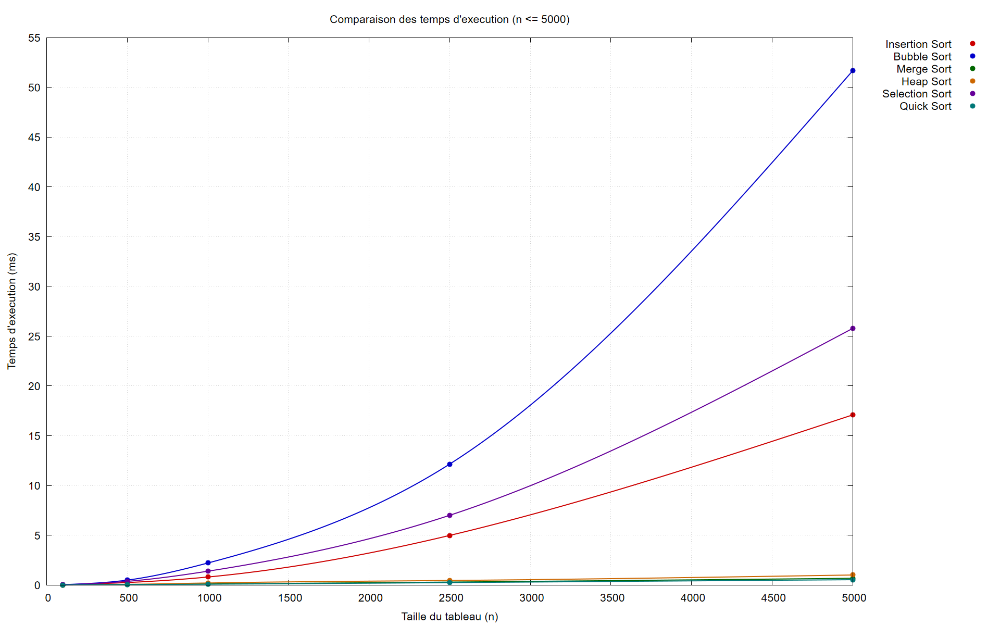
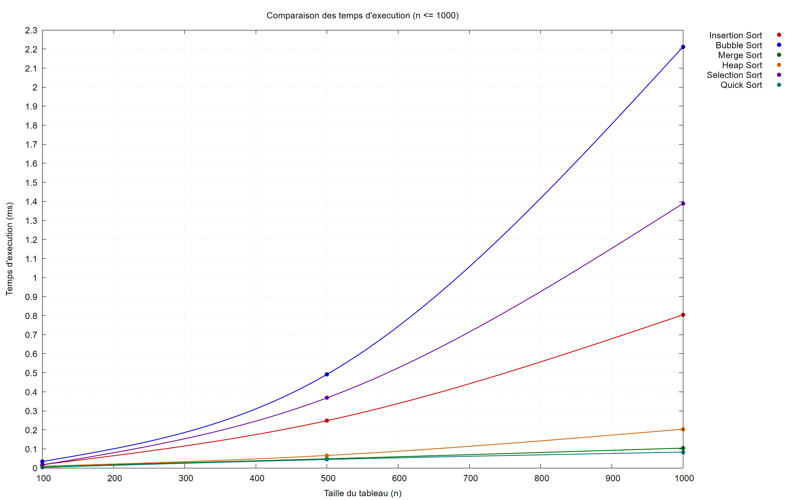
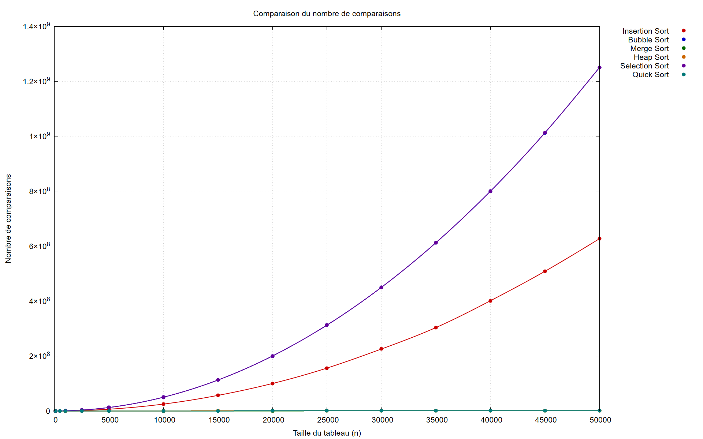
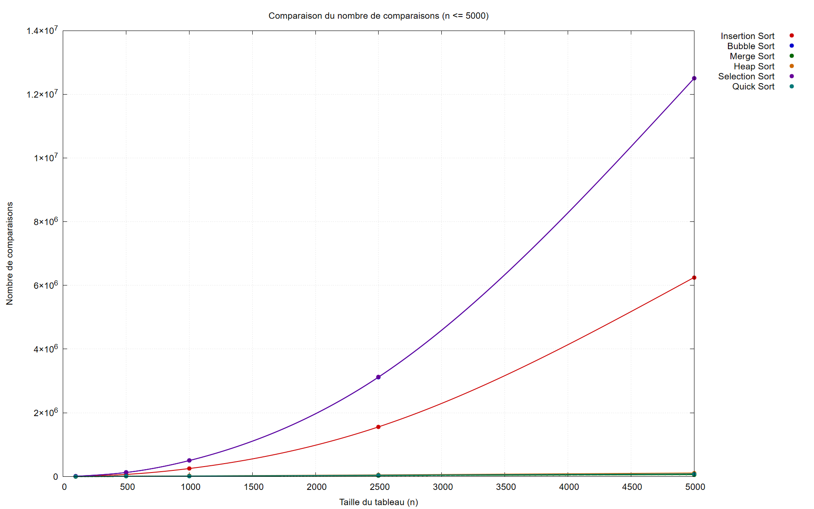
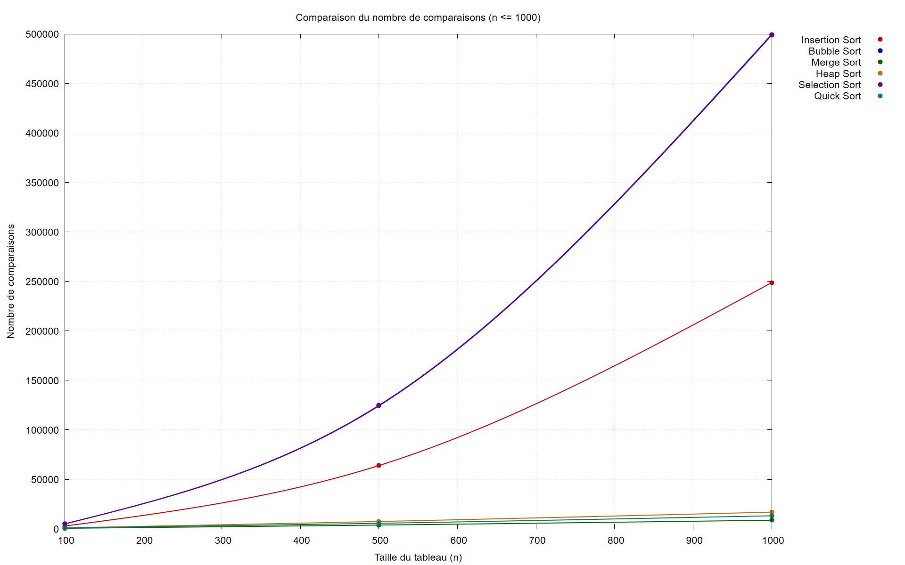
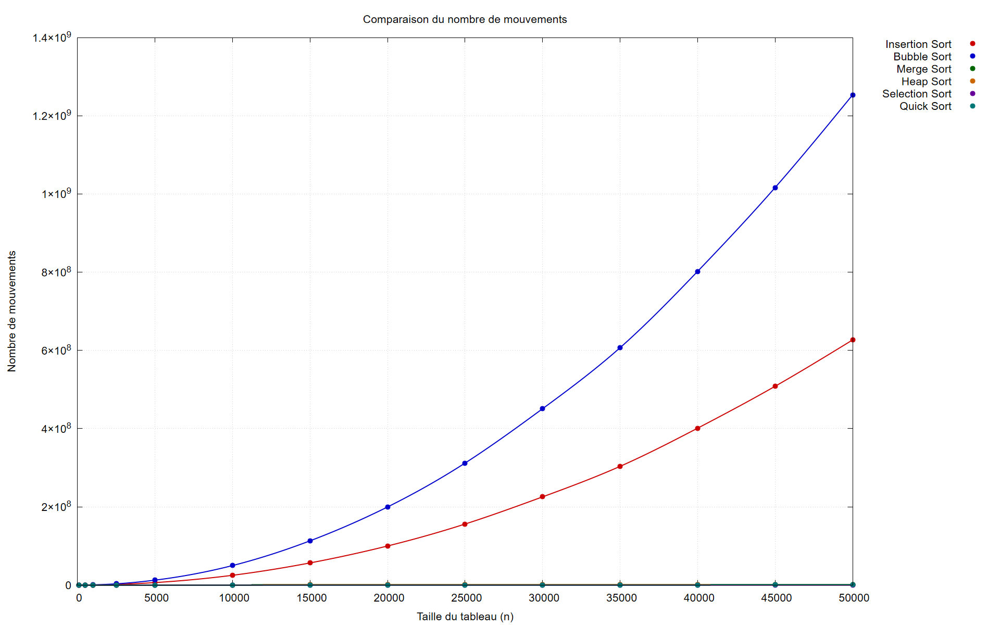
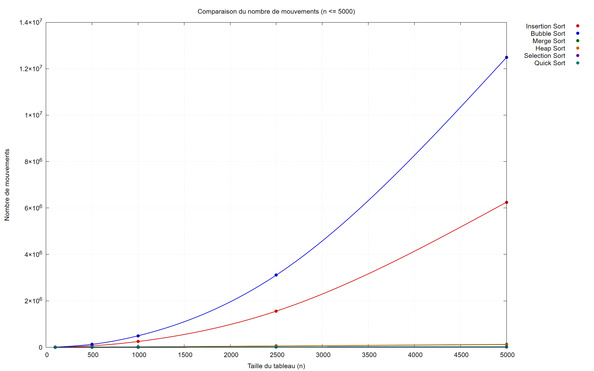
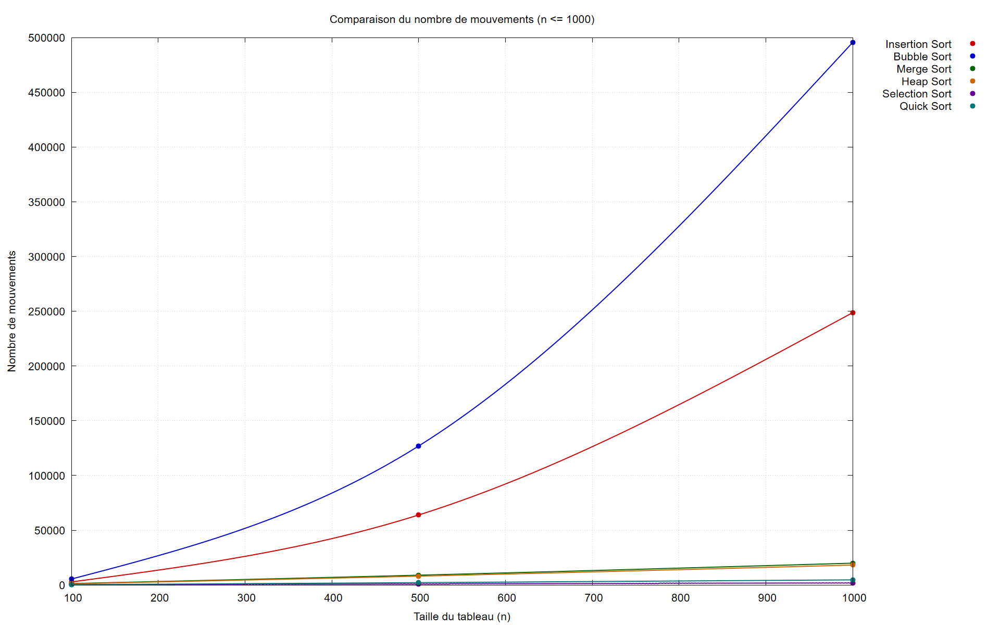

# Algorithmes de tri en C

<p align="center">
  
</p>

<p align="center">
  <em>Étude comparative • Performances • Visualisation avec GNUplot</em>
</p>

<hr>

## Description

> Étude comparative de différents algorithmes de tri implémentés en langage **C**, avec analyse de leurs performances et visualisation des résultats à l’aide de **GNUplot**.

Six algorithmes sont étudiés : **Insertion**, **Bubble**, **Selection**, **Merge**, **Heap** et **Quick sort**. Pour chacun, on mesure le **temps d’exécution**, le **nombre de comparaisons** et le **nombre de mouvements** (écritures en mémoire) sur des tableaux de tailles croissantes.

<hr>

## Sommaire

- [Structure du projet](#structure-du-projet)
- [Algorithmes étudiés](#algorithmes-étudiés)
- [Protocole expérimental](#protocole-expérimental)
- [Résultats expérimentaux](#résultats-expérimentaux)
- [Comparaison théorie / expérience](#comparaison-théorie--expérience)
- [Conclusion](#conclusion)
- [Compilation et exécution](#compilation-et-exécution)
- [Génération des graphiques](#génération-des-graphiques)

<hr>

## Structure du projet

```
algorithmes-tri-c/
├── Makefile                  # Compilation automatique (mingw32-make)
├── README.md
│
├── includes/                 # En-têtes (.h)
│   ├── benchmark.h
│   ├── data_generator.h
│   ├── data_loader.h
│   ├── results_writer.h
│   └── sorting/
│       ├── sort_stats.h
│       ├── insertion_sort.h
│       ├── bubble_sort.h
│       ├── selection_sort.h
│       ├── merge_sort.h
│       ├── heap_sort.h
│       └── quick_sort.h
│
├── src/                      # Code source (.c)
│   ├── main.c                # Point d'entrée
│   ├── benchmark/
│   │   └── benchmark.c       # Mesures de performance
│   ├── data/
│   │   ├── data_generator.c  # Génération des jeux de données
│   │   └── data_loader.c     # Lecture des fichiers de données
│   ├── results/
│   │   └── results_writer.c  # Écriture du CSV de résultats
│   └── sorting/
│       ├── insertion_sort.c
│       ├── bubble_sort.c
│       ├── selection_sort.c
│       ├── merge_sort.c
│       ├── heap_sort.c
│       └── quick_sort.c
│
├── data/
│   └── input/random/         # Données générées (ignorées par git)
│
├── results/
│   ├── graphs/               # Graphiques PNG (ignorés par git)
│   └── raw/                  # Rapport CSV des mesures (ignoré par git)
│
├── gnuplot/                  # Scripts GNUplot
│   ├── comparisons.gnuplot
│   ├── execution_time.gnuplot
│   ├── moves.gnuplot
│   ├── comparisons_1000.gnuplot
│   ├── execution_time_1000.gnuplot
│   ├── moves_1000.gnuplot
│   ├── comparisons_5000.gnuplot
│   ├── execution_time_5000.gnuplot
│   └── moves_5000.gnuplot
│
└── tests/                    # Tests unitaires par algorithme
```

### Rôles des modules

| Module | Rôle |
|---|---|
| `main.c` | Initialise les tailles, génère les données, lance les benchmarks |
| `data_generator` | Écrit les fichiers de nombres aléatoires |
| `data_loader` | Lit les fichiers en mémoire (avec validation) |
| `sorting/*` | Implémentent les six algorithmes de tri et comptent comparaisons/mouvements |
| `benchmark` | Orchestre le chargement + tri de chaque jeu de données et mesure le temps |
| `results_writer` | Écrit les mesures au format CSV |

### Flux d'exécution

```
main()
 ├── generate_random_datasets()   → data/input/random/random_<n>.txt
 └── run_all_benchmarks()
      └── run_benchmark()
           ├── load_data()          ← fichier random_<n>.txt
           └── benchmark_algorithm() pour chaque tri
                ├── copy_data() x répétitions
                ├── QueryPerformanceCounter()  (chronométrage)
                └── append_result()             → results/raw/benchmarks.csv
```

<hr>

## Algorithmes étudiés

### Complexités théoriques

| Algorithme | Meilleur cas | Cas moyen | Pire cas | Mémoire | Stable |
|---|---|---|---|---|---|
| **Insertion Sort** | O(n) | O(n²) | O(n²) | O(1) | Oui |
| **Bubble Sort** | O(n) | O(n²) | O(n²) | O(1) | Oui |
| **Selection Sort** | O(n²) | O(n²) | O(n²) | O(1) | Non |
| **Merge Sort** | O(n log n) | O(n log n) | O(n log n) | O(n) | Oui |
| **Heap Sort** | O(n log n) | O(n log n) | O(n log n) | O(1) | Non |
| **Quick Sort** | O(n log n) | O(n log n) | O(n²) | O(log n) | Non |

### Rappels sur les bornes théoriques

- **Tri par insertion** : parcourt le tableau et insère chaque élément à sa place dans la partie déjà triée. En moyenne sur des données aléatoires, il effectue environ **n²/4** comparaisons et n²/4 mouvements.
- **Tri à bulles** : compare et échange les éléments voisins. Avec l'optimisation d'arrêt anticipé, le meilleur cas est linéaire, mais le cas moyen/mauvais reste **≈ n²/2** comparaisons.
- **Tri par sélection** : recherche le minimum et l'échange. Il effectue **exactement n(n−1)/2 comparaisons** quel que soit l'entrée, mais au plus **2(n−1) mouvements** — d'où son intérêt lorsque l'écriture est coûteuse.
- **Tri par fusion** : divise récursivement puis fusionne. Toujours **≈ n log₂ n comparaisons** et environ **2n log₂ n écritures** (copie + recopie pour les données aléatoires).
- **Tri par tas** : construit un tas puis extrait le maximum. **≈ 2n log₂ n comparaisons** et mouvements dans le même ordre.
- **Tri rapide** : partitionne autour d'un pivot (ici l'élément du milieu). En moyenne **≈ 2n ln n comparaisons**, mais peut dégénérer en O(n²) sur un pivot mal choisi.

<hr>

## Protocole expérimental

- **Données** : tableaux d'entiers aléatoires dans l'intervalle `[0, 1 000 000)`, générés par `data_generator` via `rand()`.
- **Tailles testées** : `100, 500, 1000, 2500, 5000, 10000, 15000, …, 50000` (pas de 5000 au-delà de 5000).
- **Chronométrage** : `QueryPerformanceCounter` / `QueryPerformanceFrequency` (haute résolution, précision microseconde).
- **Robustesse** : chaque mesure est répétée (**7 fois** pour les tris O(n log n), **3 fois** pour les tris O(n²), plus lents) et on conserve la **médiane** pour limiter l'influence du bruit (cache, système d'exploitation).
- **Compteurs** : `comparisons` (comparaisons entre éléments) et `moves` (écritures dans le tableau) sont instrumentés directement dans chaque algorithme via `SortStats`.
- **Sortie** : `results/raw/benchmarks.csv` (`algorithm,size,time_seconds,comparisons,moves`).

<hr>

## Résultats expérimentaux

### Temps d'exécution

#### Vue complète (n = 100 → 50000)



#### Zoom sur les petites tailles (n ≤ 5000)



#### Zoom sur les très petites tailles (n ≤ 1000, en millisecondes)



**Lecture des courbes :**

- Les trois tris quadratiques (**Insertion**, **Bubble**, **Selection**) explosent dès que `n` grandit : à n = 50000, Bubble Sort atteint **≈ 7,27 s** contre **≈ 6,7 ms** pour Quick Sort, soit un facteur **~1000**.
- Les tris O(n log n) (**Merge**, **Heap**, **Quick**) restent sous la vingtaine de millisecondes sur toute la plage.
- Sur les très petites tailles (n ≤ 1000), l'ordre s'inverse : **Quick Sort** est le plus rapide (~3,1 µs à n = 100), suivi de Merge et Heap, tandis que Bubble reste le plus lent. Les écarts, faibles en valeur absolue, sont noyés dans le bruit sur les petites entrées.

Classement final à n = 50000 (du plus rapide au plus lent) :

| Rang | Algorithme | Temps (s) |
|---|---|---|
| 1 | Quick Sort | 0,00666 |
| 2 | Merge Sort | 0,01208 |
| 3 | Heap Sort | 0,01783 |
| 4 | Insertion Sort | 1,80436 |
| 5 | Selection Sort | 2,73200 |
| 6 | Bubble Sort | 7,26594 |

### Nombre de comparaisons

#### Vue complète (n = 100 → 50000)



#### Zoom sur les petites tailles (n ≤ 5000)



#### Zoom sur les très petites tailles (n ≤ 1000)



**Lecture des courbes :**

- **Selection Sort** effectue *exactement* `n(n−1)/2` comparaisons → **1 249 975 000** à n = 50000.
- **Bubble Sort** est du même ordre (**1 249 897 185**), tandis qu'**Insertion Sort** n'en fait que la moitié environ (**626 714 665 ≈ n²/4**).
- Les tris O(n log n) restent sous **1,5 million** de comparaisons : **Merge Sort** est le plus économe (**718 084**), suivi de **Quick** (**1 029 913**) et **Heap** (**1 409 578**).

### Nombre de mouvements

#### Vue complète (n = 100 → 50000)



#### Zoom sur les petites tailles (n ≤ 5000)



#### Zoom sur les très petites tailles (n ≤ 1000)



**Lecture des courbes :**

- **Selection Sort** est imbattable sur les écritures : seulement **99 986 mouvements** à n = 50000, soit `2(n−1)`, car il n'échange que le minimum de chaque passe.
- **Quick Sort** est également très économe en écritures (**375 790**), bien en dessous de Merge (**1 568 928**) et Heap (**1 474 650**).
- **Insertion** et **Bubble** dépassent le **milliard** de mouvements à n = 50000, proportionnellement à n².

<hr>

## Comparaison théorie / expérience

### Vérification des ordres de grandeur

On vérifie la loi de croissance en comparant les mesures à n = 1000 et n = 50000 (facteur **50** sur la taille).

| Algorithme | Temps(1000) | Temps(50000) | Facteur observé | Croissance attendue |
|---|---|---|---|---|
| Insertion | 0,000804 | 1,804359 | × 2243 | ×2500 (n²) |
| Bubble | 0,002211 | 7,265936 | × 3286 | ×2500 (n²) |
| Selection | 0,001389 | 2,732001 | × 1967 | ×2500 (n²) |
| Merge | 0,000105 | 0,012085 | × 116 | ×78 (n log n) |
| Quick | 0,000084 | 0,006657 | × 80 | ×78 (n log n) |

- Les tris **quadratiques** suivent bien un facteur ~**n²** (le facteur théorique pour ×50 est ×2500).
- Les tris **O(n log n)** suivent un facteur ~**80–120**, très inférieur, cohérent avec `n log n`.

### Confrontation des compteurs aux formules théoriques (n = 50000)

| Algorithme | Comparaisons mesurées | Modèle théorique | Valeur théorique | Combien de fois |
|---|---|---|---|---|
| Insertion | 626 714 665 | n²/4 | 625 000 000 | 1,00× |
| Bubble | 1 249 897 185 | n²/2 | 1 250 000 000 | 1,00× |
| Selection | 1 249 975 000 | n(n−1)/2 | 1 249 975 000 | 1,00× |
| Merge | 718 084 | n log₂ n | 780 482 | 0,92× |
| Quick | 1 029 913 | 2n ln n | 1 081 978 | 0,95× |
| Heap | 1 409 578 | 2n log₂ n | 1 560 964 | 0,90× |

| Algorithme | Mouvements mesurés | Modèle théorique | Valeur théorique | Combien de fois |
|---|---|---|---|---|
| Selection | 99 986 | 2(n−1) | 99 998 | 1,00× |
| Merge | 1 568 928 | 2n log₂ n | 1 560 964 | 1,01× |
| Quick | 375 790 | n log₂ n / 2 | 390 241 | 0,96× |
| Insertion | 626 714 680 | n²/4 | 625 000 000 | 1,00× |
| Bubble | 1 253 329 362 | n²/2 | 1 250 000 000 | 1,00× |

### Interprétation

1. **Les compteurs valident la théorie.** Les formules classiques (n²/2 pour Selection/Bubble, n log₂ n pour Merge, 2n ln n pour Quick) reproduisent les mesures à quelques pour cent près. Les écarts résiduels proviennent de la structure des données aléatoires et de la constante cachée liée à l'implémentation.
2. **Le temps suit la complexité asymptotique.** Le classement expérimental (Quick < Merge < Heap ≪ Insertion < Selection < Bubble à grande échelle) correspond exactement à celui prédit par les complexités.
3. **Temps ≠ seul nombre d'opérations.** Heap Sort fait *moins* de comparaisons que Quick Sort sur certaines entrées, mais il est plus lent en pratique : ses accès mémoire sont dispersés (sauts dans le tas, mauvais usage du cache), alors que Quick Sort parcourt le tableau de façon plus localisée. Cela illustre le poids des **constantes** et de la **localité mémoire**, invisibles dans la notation O.
4. **Selection Sort, cas particulier.** Bien que O(n²) en comparaisons, il minimise les écritures (2(n−1)), ce qui peut le rendre pertinent quand l'écriture est coûteuse (mémoire flash, par exemple).

<hr>

## Conclusion

Cette étude confirme expérimentalement la hiérarchie théorique des algorithmes de tri :

- Pour de **grandes données**, les tris **O(n log n)** (Quick, Merge, Heap) sont indispensables : ils surpassent les tris quadratiques de plusieurs ordres de grandeur.
- Parmi eux, **Quick Sort** offre le meilleur compromis temps/mémoire sur des données aléatoires ; **Merge Sort** est stable et prévisible ; **Heap Sort** garantit O(n log n) en pire cas avec une mémoire constante.
- Les tris **quadratiques** (Insertion, Bubble, Selection) ne restent acceptables que sur de **petites entrées** ; leurs compteurs suivent fidèlement les bornes n²/4 et n²/2.
- Le **tri par sélection** se distingue par son nombre minimal d'écritures.

Les mesures expérimentales **corroborent quantitativement** l'analyse théorique, tout en rappelant que les constantes et la localité mémoire influencent le temps réel.

<hr>

## Compilation et exécution

### Compilation

```bash
# Avec mingw32-make (Windows / MinGW)
mingw32-make

# ou simplement
mingw32-make all
```

Le binaire `main.exe` est généré à la racine.

### Exécution

```bash
mingw32-make run
# ou
./main.exe
```

L'exécution génère les jeux de données dans `data/input/random/` puis écrit les mesures dans `results/raw/benchmarks.csv`.

### Nettoyage

```bash
mingw32-make clean
```

<hr>

## Génération des graphiques

Les scripts GNUplot se trouvent dans `gnuplot/` et écrivent les images dans `results/graphs/`.

```bash
# Tous les graphiques d'un coup
gnuplot gnuplot/comparisons.gnuplot
gnuplot gnuplot/execution_time.gnuplot
gnuplot gnuplot/moves.gnuplot
gnuplot gnuplot/comparisons_1000.gnuplot
gnuplot gnuplot/execution_time_1000.gnuplot
gnuplot gnuplot/moves_1000.gnuplot
gnuplot gnuplot/comparisons_5000.gnuplot
gnuplot gnuplot/execution_time_5000.gnuplot
gnuplot gnuplot/moves_5000.gnuplot
```

> **Remarque** : sur Windows, si `gnuplot` n'est pas dans le `PATH`, utilisez le chemin complet, par exemple `"C:\Program Files\gnuplot\bin\gnuplot.exe"`.

Chaque algorithme possède une **couleur distincte** (fortement contrastée) et les courbes sont tracées en **points + ligne lissée** pour une meilleure lisibilité.
